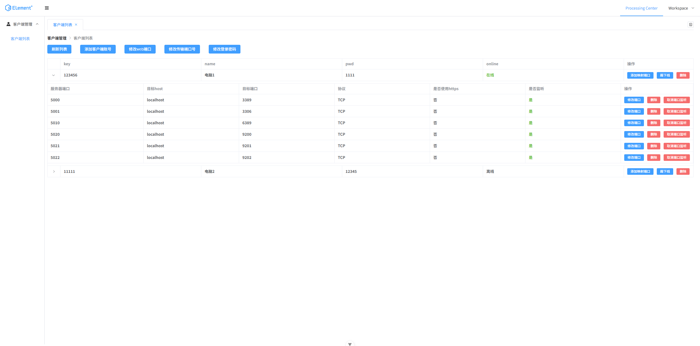

# JPierced

JPierced 是一个基于 Java 和 Netty 的内网穿透工具。它由公网侧的 **PServer** 和内网侧的 **PClient** 组成，可通过服务端管理接口为客户端创建和管理端口映射。

项目采用类似反向代理的工作方式：外部访问服务端映射端口，流量经客户端转发到内网目标地址。项目还提供 Web 管理界面，前端项目使用 Vue 3、Vite 和 Element Plus。

> 本项目实现的是基于STUN/P2P方案客户端与服务端连接转发的方案。

## 功能概览

- **多协议转发**：支持 TCP、UDP，以及 HTTP、HTTPS 场景下的端口映射。
- **动态管理**：通过 HTTP API 添加、修改、删除客户端及端口映射，也可控制客户端和映射端口的连接状态。
- **HTTP 反向代理处理**：代理过程中可改写 `Host`、`Referer`、`Location` 等 Header 中的主机与端口信息，支持 HTTP 与 HTTPS 之间的代理配置。
- **复用传输连接**：客户端与服务端使用传输通道和 ACK 控制通道，管理连接、映射和读写状态，减少重复建连。
- **连接清理**：处理客户端、目标连接及映射端口关闭时的关联连接清理。
- **Netty 传输优化**：按操作系统选择可用的传输实现（Linux 可使用 io_uring 或 epoll，macOS 使用 kqueue，Windows 使用 NIO）；数据通道使用零拷贝处理路径。
- **TLS 配置**：传输层支持 TLS。服务端和客户端可通过配置启用加密传输；启用时需正确配置证书。

## 项目结构

| 模块 | 说明 |
| --- | --- |
| `PServer` | 公网服务端、Web 管理 API、端口监听与转发 |
| `PClient` | 内网客户端，连接服务端并访问映射的目标地址 |
| `PCommons` | 客户端与服务端共用的数据结构和协议对象 |

## 管理界面



## 部署与构建

### 环境要求

- JDK 21 或更高版本（项目 Maven 配置的编译目标为 Java 21）
- Maven
- 一台具有公网 IP 的服务器运行 `PServer`
- 一台或多台内网机器运行 `PClient`

### 构建

在项目根目录执行：

```bash
mvn package
```

打包后可运行的 JAR 位于对应模块的 `target` 目录。构建配置也会将模块的资源文件复制到 `target` 中。

### 启动服务端

将 `PServer` 的可运行 JAR 和 `server.yml` 放在服务器上，然后运行：

```bash
java -jar PServer-1.0-SNAPSHOT-jar-with-dependencies.jar
```

请按实际构建产物名称调整 JAR 文件名。Linux 后台运行示例：

```bash
nohup java -jar PServer-1.0-SNAPSHOT-jar-with-dependencies.jar > server.log 2>&1 &
```

### 启动客户端

将 `PClient` 的可运行 JAR 和 `client.yml` 放在内网机器上，然后运行：

```bash
java -jar PClient-1.0-SNAPSHOT-jar-with-dependencies.jar
```

客户端连接前，先通过管理 API 创建客户端账号，并将相同的账号和密码填入 `client.yml`。使用 Docker 部署时，可参考 `PServer/Dockerfile` 和 `PClient/Dockerfile`；PClient 在容器内访问宿主机服务时，可按环境使用 `host.docker.internal`。

## 配置

配置模板位于 `PServer/src/main/resources/server.yml` 和 `PClient/src/main/resources/client.yml`。运行时请按项目启动方式将配置放在程序读取的位置，并根据实际部署修改地址、端口、账号和证书。

### PServer：`server.yml`

```yaml
transmit:
  # 客户端与服务端的数据传输端口
  port: 9998
  # 是否启用 TLS 传输
  use-ssl: true
  # ACK 控制通道端口
  ack-port: 6211

web:
  # 管理接口登录账号
  def-username: change-me
  def-password: change-me
  # Web 管理服务端口
  port: 8000
  # 是否启用管理页面和 API 的 HTTPS
  use-https: false
```

启用管理端 HTTPS 时，需要在运行环境中提供 `pierced.crt` 和 PKCS#8 格式的 `pierced.key`。可使用 OpenSSL 转换私钥：

```bash
openssl pkcs8 -topk8 -inform pem -in certificate.key -outform pem -nocrypt -out certificate-pkcs8.key
```

### PClient：`client.yml`

```yaml
server:
  # PServer 的域名或 IP
  host: your-server-host
  # PServer transmit.port 的值
  port: 9998
  # 在服务端创建的客户端账号
  username: your-client-key
  password: change-me
  # 是否启用 TLS 传输，与服务端配置保持一致
  use-ssl: true
```

仓库包含示例证书文件。生产环境建议替换为自行签发的证书，并妥善保管私钥；客户端与服务端证书应由双方信任的同一 CA 签发。TLS 配置和证书必须相互匹配。

## 管理 API

以下接口由 PServer 的 Web 服务提供。除登录接口外，请求需在 HTTP Header 中携带登录返回的 `token`。JSON 中的数字字段请使用数字类型，不要加引号。

| 功能 | 方法 | 路径 | 主要参数 |
| --- | --- | --- | --- |
| 登录 | `POST` | `/api/login` | `username`（字符串）, `pwd`（字符串） |
| 查询客户端及在线状态 | `GET` | `/api/clientList` | 可选：`key`（整数）, `name`（字符串）, `serverPort`（整数） |
| 添加客户端账号 | `POST` | `/api/addClient` | `key`（整数）, `pwd`（字符串）, `name`（字符串） |
| 修改客户端账号 | `POST` | `/api/modifyClient` | `key`、`newKey`（整数）, `pwd`、`name`（字符串） |
| 删除客户端账号 | `POST` | `/api/removeClient` | `key`（整数） |
| 断开客户端 | `POST` | `/api/shotClient` | `key`（整数） |
| 添加端口映射 | `POST` | `/api/addClientPortMapping` | `key`（整数）, `serverPort`、`port`、`protocol`（整数）, `host`（字符串）, `cliUseHttps`（布尔值） |
| 修改端口映射 | `POST` | `/api/modifyClientPortMapping` | `key`（整数）, `oldServerPort`、`newServerPort`、`port`、`protocol`（整数）, `host`（字符串）, `cliUseHttps`（布尔值） |
| 删除端口映射 | `POST` | `/api/removeClientPortMapping` | `key`、`serverPort`（整数） |
| 修改传输服务端口 | `POST` | `/api/setTrasmitPort` | `serverPort`（整数） |
| 修改 Web 服务端口 | `POST` | `/api/setWebPort` | `webPort`（整数） |
| 查询 Web 配置 | `GET` | `/api/getWeb` | 无 |
| 查询传输配置 | `GET` | `/api/getTransmit` | 无 |
| 修改管理登录账号 | `POST` | `/api/setLoginUser` | `defUsername`、`defPassword`（字符串） |
| 启动指定映射端口监听 | `POST` | `/api/listenPort` | `key`、`port`（整数） |
| 关闭指定映射端口监听 | `POST` | `/api/closePort` | `key`、`port`（整数） |

登录示例：

```http
POST /api/login
Content-Type: application/json

{"username":"管理用户名","pwd":"管理密码"}
```

添加端口映射示例：

```json
{
  "key": 1001,
  "serverPort": 8080,
  "host": "127.0.0.1",
  "port": 80,
  "protocol": 2,
  "cliUseHttps": false
}
```

映射的 `serverPort` 是公网服务端监听端口；`host` 和 `port` 是 PClient 所在网络中可访问的目标地址。`protocol` 数值为 `1` TCP、`2` HTTP、`3` HTTPS、`4` UDP。修改传输端口会断开现有客户端，客户端需改用新端口重新连接。JSON 中的整数请直接写数字，例如 `"key": 1001`，不要写成字符串 `"key": "1001"`。

## 相关链接

- [Gitee 仓库](https://gitee.com/lijiann/JPierced.git)
- [GitHub 仓库](https://github.com/849029780/JPierced.git)
- [管理端前端（Vue 3）](https://github.com/849029780/jpierced-frontend)
